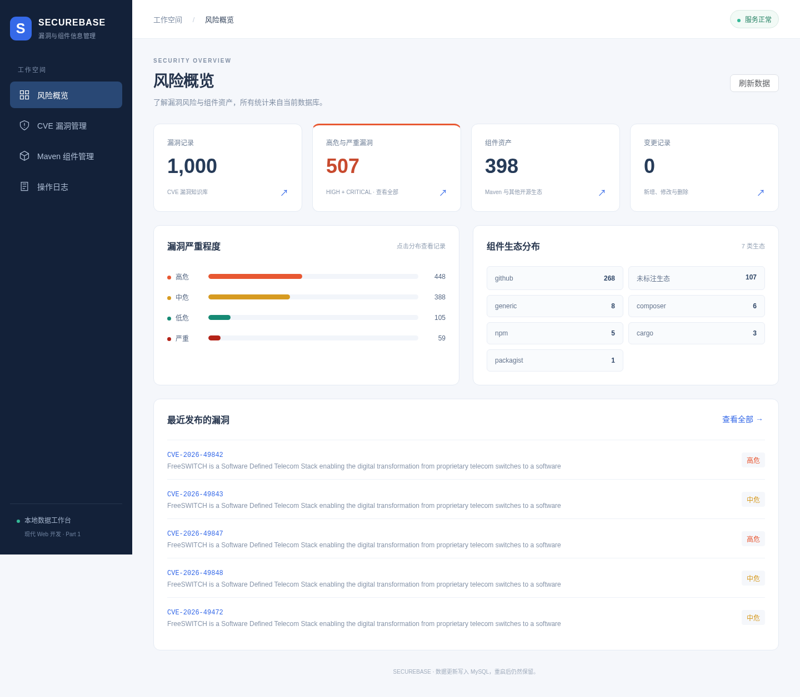

# SECUREBASE · 漏洞与组件信息管理系统

《现代 Web 开发》实践作业一。使用 Vue 3、TypeScript、Element Plus、Express、mysql2 和 MySQL，实现教师数据导入、漏洞管理与组件 CRUD。所有开发、启动、构建和测试均在 Docker 中执行。

## 1. 功能与范围

| 页面 | 能力 |
| --- | --- |
| 风险概览 | 实时记录总数、高危数量、严重程度分布、组件生态分布、最近发布漏洞；点击图表跳转筛选 |
| CVE 漏洞管理 | ID / CVE 编号 / 标题 / 描述检索、分页、严重程度筛选、完整详情、编辑、删除确认；不提供新增 |
| Maven 组件管理 | ID / 名称 / PURL 检索、分页、生态筛选、详情、新增、编辑、删除确认 |
| 操作日志 | 记录新增、修改和删除，查看变更前后快照；日志与业务变更在同一数据库事务中提交 |
| 通用能力 | 必填和格式校验、加载和空状态、错误反馈、重复 PURL 检查、并发修改冲突提示、手机布局 |

教师原始 SQL 包含 **1000 条漏洞、398 条组件**。组件文件实际上涵盖多个生态，未包含 Maven 记录；本项目保留全部原始组件数据，新建组件默认使用 Maven 坐标。不要为了页面名称而丢弃其他生态数据。漏洞标题或组件版本未提供时，显示描述摘要或“未提供”。

创意功能为风险可视化和操作日志；应用没有 Agent 能力。系统定位为本地课程管理工具，未实现登录、用户权限、漏洞扫描或自动判断组件是否受某个漏洞影响。



## 2. 系统结构

```text
本机浏览器 → SSH 端口转发 → Vite :5173 → /api 代理 → Express :3000 → MySQL :3307
                              └── 同一 app 容器 ──┘                 db 容器
```

- 前端负责展示、交互与表单校验，不直接连接数据库。
- 后端负责 REST API、最终校验、参数化 SQL、事务与操作日志。
- MySQL 保存业务数据，使用 `mysql_data` 命名卷实现持久化。
- `app` 内由 concurrently 同时运行前后端；任一进程退出会终止另一进程，便于发现启动失败。
- 两个服务均使用 `network_mode: host`，不创建隔离网络，不设置端口映射。服务通过服务器 `127.0.0.1` 通信，不能使用桥接网络中的 `db` DNS 名称。
- 仓库以 `.:/workspace` **挂载**进容器。Dockerfile 只构建运行环境，**不复制源码**，源码更新无需重建镜像。
- `node_modules` 使用命名卷。npm 缓存、浏览器下载、测试临时输出均存放在仓库 `tmp/`，容器中为 `/workspace/tmp`，不提交 Git。

## 3. 环境要求

推荐当前服务器使用的 **Linux + Docker Engine + Docker Compose**。宿主机无需安装 Node.js、npm 或 MySQL。需要有操作 Docker socket 的权限，以及访问镜像、npm 和 Debian 官方源的网络。

此 Compose 明确使用 host 网络，主要面向 Linux 服务器；Windows 本机只作为浏览器和 SSH 客户端。若要直接在 Windows Docker Desktop 运行，需确认并启用其 host 网络支持，不能把 Linux host 模式当成默认跨平台配置。

镜像来源是 **AWS ECR Public 的 Docker 官方镜像**：

- `public.ecr.aws/docker/library/node:22-bookworm-slim`
- `public.ecr.aws/docker/library/mysql:8.4`

不直连 Docker Hub。来源依据：[AWS 官方公告](https://aws.amazon.com/blogs/containers/docker-official-images-now-available-on-amazon-elastic-container-registry-public/)。浏览器运行库从 Debian 官方源安装，Playwright 浏览器从官方 CDN 下载到 `tmp/playwright/`。镜像标签会更新，npm 依赖的实际版本由 `package-lock.json` 固定。

开发镜像以 `node` 用户（UID/GID 1000）运行，与当前服务器用户一致。换服务器时请确保挂载目录对 UID 1000 可写；不要用宿主机 root 执行 npm。

## 4. 首次启动（服务器）

在仓库根目录执行：

```sh
# 首次创建配置；脚本随机生成两个数据库口令，已有 .env 时不会覆盖
sh docker/setup-env.sh

# 构建镜像、启动 MySQL 和前后端
# 首次自动安装依赖、建表并导入教师数据
mkdir -p tmp
docker compose up -d --build --wait --wait-timeout 300

# 查看健康状态及日志
docker compose ps
docker compose logs -f app db
```

首次下载较慢时，日志用于判断实际进度；`--wait-timeout` 超时不代表容器已停止。先检查 `ps` 和日志，不要反复删除数据卷。

预期 `app` 与 `db` 都为 `healthy`。前端显示“服务正常”，首次风险概览为 1000 条漏洞、398 条组件。操作日志初始为 0；导入不算用户操作。

日常启动已创建的环境：

```sh
docker compose up -d --wait --wait-timeout 300
```

启动脚本每次按锁文件执行 `npm ci`、运行幂等初始化，再启动开发服务。依赖变化后重启 app 即可，修改普通源码则自动热更新。

## 5. Windows PowerShell 访问与调试

你当前 SSH config 别名为 `jerryFduServer`。在**Windows 本机 PowerShell**执行一行：

```powershell
ssh -N -o ExitOnForwardFailure=yes -L 5173:127.0.0.1:5173 -L 3000:127.0.0.1:3000 jerryFduServer
```

保持窗口打开，访问：

- 前端：<http://localhost:5173>
- 后端健康检查：<http://localhost:3000/api/health>
- 经前端代理的健康检查：<http://localhost:5173/api/health>

`-N` 表示只转发，不打开登录 shell。连接后没有输出是正常的；想同时登录服务器就去掉 `-N`。SSH config 中的用户名、地址、端口与密钥会继续生效。结束会话可按 Ctrl+C。

只转发 5173 即可完整使用页面，因为前端通过相对路径 `/api` 发请求，Vite 在服务器端代理到 API。转发 3000 主要便于直接检查后端。不要把前端 API 地址写成服务器的 localhost 绝对地址，让浏览器错误地访问 Windows 本机。

本机端口被占用时：

```powershell
ssh -N -o ExitOnForwardFailure=yes -L 15173:127.0.0.1:5173 -L 13000:127.0.0.1:3000 jerryFduServer
```

此时访问 <http://localhost:15173>。前端热更新 WebSocket 也通过转发连接工作。

浏览器按 F12 打开 Network，搜索 `api`，进行一次编辑并保存，可看到 `PATCH` 请求、提交字段、HTTP 200 与返回数据。删除成功返回 204，无响应体。

若需要用服务器 IP 直接访问，在 `.env` 设置 `WEB_HOST=0.0.0.0` 后执行 `docker compose up -d`，访问 `http://服务器IP:5173`，并确保服务器防火墙或云安全组允许该端口。默认仍推荐 SSH 转发；API 和数据库始终只监听回环地址。

## 6. 页面使用说明

### 风险概览

统计来自 `/api/stats` 对真实数据库的聚合查询。严重程度条形图可点击，组件生态卡片可跳转对应筛选。高危指标合计 HIGH 与 CRITICAL，点击指标进入“高危与严重”合并筛选；也可单独点击对应分布。更新数据后回到概览或点“刷新数据”，即可看到最新统计。

### CVE 漏洞管理

1. 输入内部 ID、CVE 编号、标题或描述关键词，点击“搜索”或按 Enter；“重置”清除所有筛选。
2. 严重程度可单独筛选；底部分页支持 10、20、50、100 条每页。
3. 点击编号或“详情”，查看来源、描述、影响范围、CWE、三个版本的评分及日期。标题为空时列表使用描述摘要。
4. 点击“编辑”，修改字段，点击“保存”。CVE 编号与内部 ID 作为定位信息，不在表单中编辑。
5. 评分允许 0–10 或空值。影响范围、CWE 每行一项；CWE 格式为 `CWE-数字`。描述必填，来源链接只能使用 HTTP(S)。
6. 点击“删除”，核对编号后确认。取消不会发送删除请求；确认后从数据库永久删除并保留日志。

复杂原始字段不丢弃，但不要求手工录入整条 CVE，所以页面没有新增按钮和新增 API。

### Maven 组件管理

1. 搜索内部 ID、名称或 PURL；生态筛选可选 Maven 及教师数据中的其他类型。
2. 点击“新增组件”，默认选择“Maven 坐标”，输入例如：

   ```text
   groupId:    org.example
   artifactId: demo-library
   版本:       1.0.0
   ```

   自动生成 `pkg:maven/org.example/demo-library@1.0.0`，名称取 artifactId，命名空间取 groupId，类型为 maven。
3. 也可切换“通用组件”，自行输入名称、PURL、版本、生态等；PURL 以 `pkg:` 开头，且全表唯一。新增版本必填。
4. 许可证、描述、仓库链接、语言、CPE 和日期可选。点击保存后会写入 MySQL。
5. 点击详情检查记录；编辑已有字段，保存后列表刷新。更新版本时请同时调整需要保持一致的 PURL。
6. 教师历史组件版本可能为空，编辑时允许保留；重复 PURL 会提示冲突，保留表单内容供修正。
7. 删除前确认。删除当前页最后一条记录时自动回到有效页码。

### 操作日志

日志记录资源 ID、业务标识、操作类型和 UTC 时间，点击“查看变更”可查看 JSON 快照。新增的 before 为 null，删除的 after 为 null。记录被删除后日志仍然存在。

系统没有登录，因此日志不宣称能识别操作者。它用于追踪本地课程操作，不能作为有身份认证的审计系统。

### 错误与并发

失败时保留表单并显示字段提示。记录已删除返回 404；PURL 重复或记录版本过期返回 409。两个人同时编辑时，后保存的一方需关闭窗口并重新打开，基于新数据修改；不要盲目覆盖。网络中断时列表显示错误和重试按钮，顶部状态每 30 秒检查，也可点击立即检查。

## 7. 配置说明

`.env` 被 Git 忽略；初始化脚本为应用账号和数据库管理员生成不同的随机口令。`.env.example` 只列配置键，不包含可用口令。不要把 `.env`、`docker compose config` 的完整输出或含密码的日志上传、截图或加入提交包。

| 配置 | 默认 | 说明 |
| --- | --- | --- |
| MYSQL_DATABASE | webdev | 数据库名 |
| MYSQL_USER | webdev | 应用账号 |
| MYSQL_PASSWORD | 无固定默认值，首次生成 | 应用账号口令；缺失时 Compose 拒绝启动 |
| MYSQL_ROOT_PASSWORD | 无固定默认值，首次生成 | 数据库管理员口令；缺失时 Compose 拒绝启动 |
| DB_PORT | 3307 | host 网络 MySQL 监听端口 |
| API_PORT | 3000 | 后端监听端口 |
| FRONTEND_PORT | 5173 | 前端端口；修改后 SSH 转发同步修改 |
| WEB_HOST | 127.0.0.1 | 前端监听地址 |

配置变化后执行 `docker compose up -d` 重建相关容器。host 网络下不能重复占用宿主机端口；Vite 使用 strictPort，端口冲突会明确失败。

已初始化 MySQL 的用户名和口令保存在数据卷里，修改环境变量不会自动修改数据库账号。应通过数据库管理操作同步修改；不要为了换口令删除业务数据。

当前服务器需要轮换旧口令时，可在仓库根目录运行 `python3 docker/rotate-local-passwords.py`。脚本通过数据库连接更改应用和 root 账号口令，更新 Git 忽略的 `.env`，并重建两个容器；不会显示新旧口令。执行前确认没有其他人正在编辑数据，运行后检查 `docker compose ps`。这是主机上的配置管理操作；前后端安装、运行和测试仍在 Docker 内进行。

## 8. 数据库与可重复初始化

```sh
docker compose exec app npm run db:init
```

首次启动已自动执行。手工重复执行是安全的：建表脚本使用 `IF NOT EXISTS`，初始化使用数据库锁避免并发导入，`teacher-data-v1` 标记保证仅导入一次。

执行流程：

1. 建立迁移记录、漏洞、组件和日志表。
2. 在同一数据库连接中读取教师 SQL，按引号和转义规则分割语句。
3. 将原始表改为连接级临时表，将 INSERT 的 `osscore.` 前缀移除，避免硬编码数据库名。
4. 按原字段名映射复制进业务表，保留空值、原描述、评分、影响范围与关联信息。
5. 业务数据与导入标记在一个事务中提交。失败回滚，重新执行可重试。
6. 后续初始化发现标记后跳过数据导入，不恢复已删除记录，不覆盖编辑。

字段映射见 [实验报告](docs/实验报告.md)。新增内部自增 ID 便于 API 定位，组件 PURL 仍有唯一约束；漏洞的 CVE 编号不强加唯一约束，因为原始表没有这样的保证。所有数据库日期按 UTC 展示，来源日期与本系统更新时间分开保存。

**停止与持久化：**

```sh
docker compose stop
docker compose start
# 或移除容器但保留数据卷
docker compose down
docker compose up -d --wait --wait-timeout 300
```

不要在需要保留数据时运行 `docker compose down -v`，该选项会删除数据库和依赖卷。需要重复演示可新建测试记录；不要把清库当作普通初始化。

## 9. 开发说明

### 目录与职责

```text
frontend/src/
  App.vue                 导航、路由、服务状态
  api.ts                  HTTP 客户端、错误类型和显示工具
  fields.ts               表单/详情字段配置
  style.css               统一布局、图表样式与响应式适配
  components/
    Dashboard.vue         统计与可视化
    Manager.vue           两个资源的列表、详情、搜索、分页和删除
    EntityForm.vue        新增/修改、Maven 坐标生成、前端校验
    Logs.vue              操作日志和快照
backend/src/
  server.ts               Express 入口、健康检查、统一 JSON 错误
  routes.ts               REST 路由、数据库事务、日志与统计
  validation.ts           参数、字段白名单、格式和范围校验
  db.ts                   MySQL 连接池
  init-db.ts              幂等建表与教师 SQL 导入
  sql.ts                  SQL 语句分割器
backend/sql/              可重复执行的建表脚本
databases/                未修改的教师原始 SQL
docker/                   运行环境、启动脚本与健康检查
tests/                    单元、接口、导入核对、持久化与浏览器测试
docs/                     作业说明、实验报告、API 文档与演示材料
tmp/                      缓存、下载、截图、测试结果等临时文件
```

### 日常开发命令

在服务器仓库目录执行，命令通过 Compose 进入容器：

```sh
# 类型检查、构建
docker compose exec app npm run check
docker compose exec app npm run build

# 单元和真实数据库接口测试
docker compose exec app npm test

# 安装官方 Chromium 到仓库 tmp/（首次浏览器测试前执行）
docker compose exec app npm run browser:install
# 浏览器端到端测试
docker compose exec app npm run test:e2e

# 进入开发容器
docker compose exec app sh
# 添加依赖，锁文件会写回挂载的仓库
docker compose exec app npm install -w frontend 包名
docker compose exec app npm install -w backend 包名

# 查看日志、重启前后端
docker compose logs -f app
docker compose restart app
```

源码由 Vite 和 tsx 自动监听，编辑后无需重新构建 Docker。修改 Dockerfile 或浏览器系统运行库才执行 `docker compose up -d --build`。构建产物是 `frontend/dist` 和 `backend/dist`，Compose 仍运行开发服务；这不是生产部署配置。

### 增加字段或功能

1. 在 `backend/sql/` 添加明确的迁移，保留现有数据；不能只改 `CREATE TABLE IF NOT EXISTS` 期待旧表自动新增列。
2. 更新后端字段白名单和校验，再修改路由查询/返回字段。动态 SQL 的表名与字段名只能来自代码白名单，用户值使用占位符。
3. 更新 `frontend/src/fields.ts`、页面展示与 API 文档。
4. 添加验证新行为的测试，在容器内执行 check、test 和相关浏览器用例。

查询采用服务端分页。PATCH 只接受允许字段和 revision；先锁定记录，检查版本，再更新业务数据和日志，最后提交。DELETE 的 revision 查询参数可选，页面始终发送以避免误删已变更记录。

## 10. 验证与验收

### 导入原始字段核对

在**初次导入、尚未修改或删除教师记录**时执行：

```sh
docker compose exec app npm run verify:import
```

该命令把教师 SQL 导入连接级临时表，逐条比较业务表中的全部原始字段，不改业务数据。正常使用后数据已修改，核对出现差异是预期现象，因此不作为日常测试要求。

### 持久化验证

使用独立标记的测试记录，不修改教师记录：

```sh
docker compose exec app node tests/persistence-fixture.mjs prepare
docker compose up -d --force-recreate --wait --wait-timeout 300
docker compose exec app node tests/persistence-fixture.mjs verify
```

验证组件与漏洞的修改仍存在、已删除记录仍为 404、日志保留。verify 成功后自动清理独立测试记录。若中途失败可执行：

```sh
docker compose exec app node tests/persistence-fixture.mjs cleanup
```

普通接口和浏览器测试也使用独立夹具并在 finally 中清理，不删除教师记录。测试需要正在运行的服务与数据库；不要把测试夹具误当成业务数据。

浏览器报告在 `tmp/playwright-report/`，失败截图、视频和 trace 在 `tmp/test-results/`。视频演示及复现方法见 [演示说明](docs/演示说明.md)，接口详情见 [API 文档](docs/API.md)，报告见 [实验报告](docs/实验报告.md)。

## 11. 常见问题

| 现象 | 排查或处理 |
| --- | --- |
| PowerShell 的 SSH 没输出 | `-N` 正常；保持窗口并访问浏览器。需要登录终端则去掉 `-N` |
| `bind: Address already in use` | 本机 SSH 转发端口冲突则改本地端口；服务器服务端口冲突则改 `.env` 后重建 |
| 浏览器连不上 | 检查 SSH 会话、正确的 localhost 端口、`docker compose ps` 和日志 |
| 页面显示数据库异常 | 检查 db 健康状态、数据库端口和已有数据卷中的账号是否匹配 `.env` |
| `permission denied` 访问 Docker socket | 使用服务器授予的 Docker 权限；不要通过改成全员可写绕过权限 |
| `npm ci` 锁文件不一致 | 在 app 容器执行 npm install 更新锁文件，再检查和测试 |
| 修改源码没有刷新 | 确认当前目录是 Compose 挂载的仓库、浏览器热更新连接可用；必要时刷新页面 |
| Chromium 缺失 | 容器执行 `npm run browser:install`，不要在宿主机安装或用外部临时路径 |
| 编辑显示版本冲突 | 关闭表单并重新打开，核对最新内容后保存 |
| 重新初始化后没有恢复已删数据 | 正确行为，导入标记避免覆盖业务状态 |

## 12. 提交材料

提交源代码、package-lock.json、Compose/Dockerfile、数据库脚本、README、[实验报告](docs/实验报告.md)及[演示材料](docs/演示说明.md)。不提交 `.env`、node_modules、构建缓存或 tmp/。真实密码、令牌和密钥不得加入仓库。

提交前可在仓库根目录运行 `python3 scripts/package_submission.py`，生成 `submission/实践作业一-提交包.zip` 和对应的 SHA-256 校验文件。脚本只收录审查过的项目文件，并拒绝把当前有效数据库口令、私钥或令牌放入压缩包。[本次复验记录](docs/复验记录-2026-10-08.md)列出最新检查结果。

实验报告记录了本次实现的决策、AI 提示与验证过程；提交者应阅读关键代码并补充本人信息、实际演示形式和自己的学习总结，确保能解释一次请求从表单到数据库的完整过程。

### 下载报告与录屏到 Windows

在本机 PowerShell 执行（目标为当前目录）：

```powershell
scp "jerryFduServer:/home/jerryjwc/_reps/advanced-web-development_pj1/docs/实验报告.md" .
scp "jerryFduServer:/home/jerryjwc/_reps/advanced-web-development_pj1/docs/项目演示.webm" .
```

录屏为 1440×1000 的 WebM，实际时长 5 分 45.76 秒，约 24 MB，含中文字幕、无音轨。Chrome/Edge 可直接打开下载后的文件。如课程要求本人讲解，可按演示说明重新录制或添加讲解。
